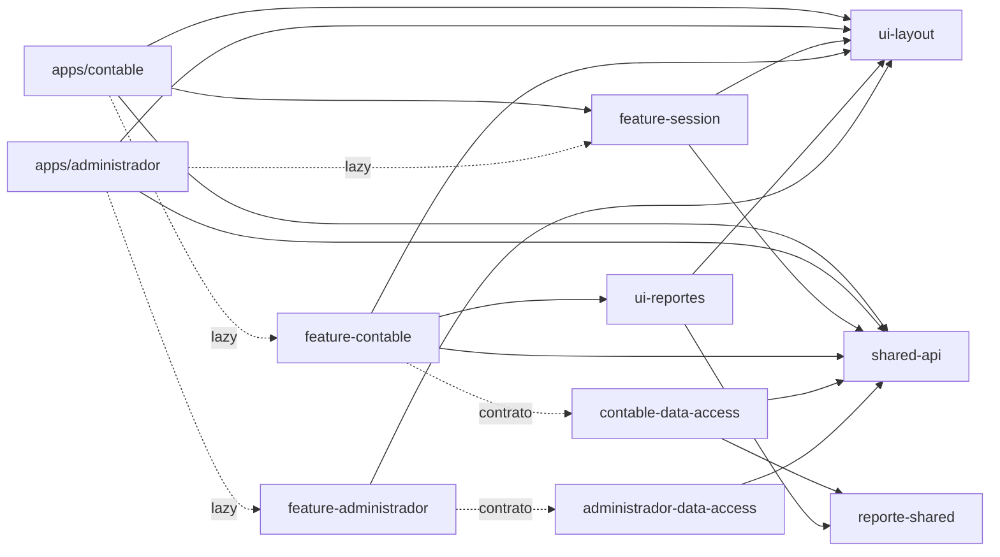

# Eterea · Clientes multiempresa


Clientes Angular para operar la contabilidad y la administración de varias
empresas desde un mismo espacio de trabajo. Incluye autenticación contra Brain,
selección de contexto empresa → negocio y los primeros módulos operativos:
plan de cuentas, ejercicios, coeficientes de inflación, balance e informes en
Contable; empresas, negocios, usuarios y asignaciones en Administrador.

## Stack

- **Angular 22.1** (standalone components, signals y rutas lazy).
- **Nx 23.3** como workspace multi-app (`apps/` + `libs/`).
- **TypeScript 6.0** en modo `strict` con `strictTemplates`.
- **Tailwind CSS 4.2** como base de estilos, con un sistema de diseño propio en CSS.
- **Vitest 4** previsto para pruebas (targets y configuración pendientes).
- **ESLint 9 + Prettier 3** con reglas de límites entre librerías.
- **Node.js 22 + npm 11** como toolchain (validado en CI).
- **Docker** multietapa con Nginx para publicar las apps.

## Puesta en marcha

```bash
npm install
npm start                    # contable en http://localhost:4220
npm run start:administrador  # administrador en http://localhost:4221
npm run build                # build de producción de contable
npm run build:administrador  # build de producción de administrador
npm run lint                 # lint de todos los proyectos
```

## Estructura

```text
apps/
├── contable/                   # host: bootstrap, rutas raíz y shell
└── administrador/              # host de administración global
libs/
├── shared-api/                 # sesión, tenant, interceptores, tokens, env y formato
├── ui-layout/                  # sistema de diseño: shell, iconos, page header
├── feature-session/            # login, cambio de contraseña y selector de contexto
├── contable-data-access/       # modelos y contratos + repositorios HTTP contables
├── feature-contable/           # rutas y páginas del módulo contable
├── reporte-shared/             # contrato genérico de reportes (ReporteDatos)
├── ui-reportes/                # shell de reportes, vista previa, descarga e impresión
├── administrador-data-access/  # modelos y contrato + repositorio HTTP de administración
└── feature-administrador/      # rutas y páginas del módulo administrador
```

### Capas

- **`apps/contable`** y **`apps/administrador`** son cascarones delgados:
  `main.ts`, `app.config.ts`, `app.routes.ts` y el shell. Las vistas no viven en
  las apps.
- **`feature-*`** contiene las vistas. `feature-contable` y
  `feature-administrador` se cargan con `loadChildren`; `feature-session` se
  importa de forma estática porque el shell de Contable también usa el diálogo de
  cambio de contexto.
- **`shared-api`** resuelve la sesión y el contexto multiempresa:
  - `AuthStore` mantiene el access token en memoria y expone el usuario activo.
  - `ContextoStore` mantiene la jerarquía empresa → negocio y la selección activa
    en `sessionStorage` (una por solapa).
  - `contextoInterceptor` agrega `X-Tenant-Id` con `negocio.tenantId`.
  - `contextoGuard` exige empresa y negocio elegidos.
  - `API_URL`, `APP_ENV_INFO` y helpers de formato son transversales.
- **`contable-data-access`** define los modelos y contratos contables, más sus
  implementaciones HTTP contra `/api/tenant/core`: cuentas, ejercicios,
  coeficientes de inflación, reporte de Plan de Cuentas y balance. `ContableRepository`
  (snapshot del módulo) sigue sin implementación.
- **`administrador-data-access`** define los modelos de empresa, negocio, usuario
  y asignaciones, el contrato `AdministradorRepository` y su implementación HTTP
  `AdministradorHttpRepository` contra `/api/brain/core`. El cliente de
  administración es global: no depende de una empresa activa.
- **`reporte-shared`** define el contrato genérico `ReporteDatos`; **`ui-reportes`**
  lo consume para armar la vista previa, la descarga de PDF y la impresión.
- **`ui-layout`** concentra la identidad visual y no depende de ninguna otra
  librería del workspace.



Los límites están enforced por `@nx/enforce-module-boundaries` en
`eslint.config.mjs`.

## Rutas

### Contable

| Ruta                      | Pantalla                   | Estado      |
| ------------------------- | -------------------------- | ----------- |
| `/`                       | Redirige a `/plan-cuentas` | redirección |
| `/plan-cuentas`           | Plan de cuentas            | operativa   |
| `/reportes/plan-cuentas`  | Reporte de Plan de Cuentas | operativa   |
| `/ejercicios`             | Ejercicios contables       | operativa   |
| `/inflacion/coeficientes` | Coeficientes de inflación  | operativa   |
| `/balance`                | Balance (informe)          | operativa   |
| `/login`                  | Ingreso                    | operativa   |
| `/empresas`               | Selector empresa → negocio | operativa   |
| `/cambiar-password`       | Cambiar contraseña         | operativa   |

### Administrador

| Ruta                | Pantalla                          | Estado     |
| ------------------- | --------------------------------- | ---------- |
| `/`                 | Resumen de la plataforma          | estructura |
| `/empresas`         | Empresas registradas              | operativa  |
| `/negocios`         | Negocios y conexiones             | operativa  |
| `/usuarios`         | Usuarios de la plataforma         | operativa  |
| `/asignaciones`     | Usuario–empresa y usuario–negocio | operativa  |
| `/configuracion`    | Parámetros generales              | estructura |
| `/login`            | Ingreso                           | operativa  |
| `/cambiar-password` | Cambiar contraseña                | operativa  |

## Autenticación y sesión

- Login común: `POST /api/brain/auth/login` (`shared-api` + `feature-session`).
- Cambio de contraseña: menú del usuario → `/cambiar-password`; usa
  `PUT /api/brain/core/usuario/{usuarioId}/password`, exige la contraseña actual y
  cierra la sesión al guardar.
- Access token JWT en memoria; refresh token opaco en cookie `HttpOnly`/
  `SameSite=Strict`, compartida entre solapas.
- `authInterceptor` agrega el Bearer y refresca una vez ante `401`.
- Guards: `authGuard`, `guestGuard`, `adminGuard`, `contextoGuard` y
  `pendingPasswordChangeGuard` (bloquea el shell hasta definir una clave nueva).
- El módulo Administrador exige `administrador = true`; Contable carga las
  empresas/negocios asignados y usa `negocio.tenantId` como `X-Tenant-Id`.
- En desarrollo, `proxy.conf.json` redirige `/api` al gateway en
  `http://localhost:9050`.

## Reportes

- El PDF se genera en el core con OpenPDF; el frontend pide los datos para la
  vista previa (`POST /api/tenant/core/reporte/<slug>/datos`) o el binario para
  descargar e imprimir (`POST .../<slug>/pdf`).
- El tenant viaja en `X-Tenant-Id`; el body no incluye `tenantId` ni `negocioId`.
- `reporte-shared` define `ReporteDatos` y `ui-reportes` resuelve vista previa,
  descarga de PDF, impresión y exportación XLSX cuando el reporte la habilita.
  Los reportes operativos son `/reportes/plan-cuentas` y el informe `/balance`,
  que además elige moneda de registro y de expresión.

## Sistema de diseño

Identidad propia: **tinta editorial + ultramar eléctrico + lima ácida**.

- Tokens en `libs/ui-layout/src/styles/tokens.css` (tema claro y oscuro).
- Primitivas globales en `libs/ui-layout/src/styles/ui.css`: botones, tarjetas,
  campos, badges, tablas y utilidades.
- Shell responsive en `libs/ui-layout/src/lib/shell`, con navegación agrupada,
  contexto empresa/negocio, usuario y cambio de tema.
- Componentes compartidos: `et-icon`, `et-page-header`, `et-empty-state`.
- Tipografías: Sora (títulos), Inter (texto) y JetBrains Mono (importes).

Las reglas de uso están en [`AGENTS.md`](./AGENTS.md).

## Estado actual y próximos pasos

Listo:

- Workspace Nx con dos apps, nueve librerías y aliases `@eterea/*`.
- Shell, navegación, tema claro/oscuro, indicador de entorno y diseño responsive
  en ambos módulos.
- Contexto multiempresa (`ContextoStore`, interceptor, guard), pantalla
  obligatoria empresa → negocio, cambio de contexto en modal y persistencia por
  solapa.
- Login común contra Brain con JWT en memoria, refresh token en cookie HttpOnly,
  guards de sesión/rol, logout y carga real de empresas/negocios asignados.
- Cambio de contraseña desde el menú de usuario en ambos módulos, con cierre de
  sesión al completar.
- Contable: plan de cuentas con árbol, alta/edición/baja, ejercicios con bloqueo
  y eliminación, coeficientes de inflación mensuales y reporte de Plan de Cuentas
  con vista previa, PDF e impresión.
- Contable: balance general y por cuenta con rango de fechas, apertura, asientos
  de inflación, monedas de registro y expresión, vista previa, PDF, impresión y
  exportación XLSX.
- Administrador: alta y edición de empresas y negocios (con `tenantId` generado
  en el cliente), listado de usuarios, blanqueo de contraseñas y asignaciones
  usuario–empresa / usuario–negocio con activación, desactivación y cascada.
- Build de producción, lint sin errores y CI en GitHub Actions.

Pendiente de implementar por pasos:

1. Implementación HTTP de `ContableRepository` (snapshot del módulo contable).
2. Asientos, mayor, períodos y centros de costo.
3. Pruebas unitarias de las capas de datos y de los cálculos contables.
4. Pipeline de despliegue y configuración de entornos.

## Docker

```bash
npm run docker:build
docker run --rm -p 8080:443 \
  -e API_URL=/api/tenant/core \
  -e ENV_NAME=local \
  -e APP_VERSION=local \
  eterea/contable:local

npm run docker:build:administrador
docker run --rm -p 8081:443 \
  -e API_URL=/api/brain/core \
  -e ENV_NAME=local \
  -e APP_VERSION=local \
  eterea/administrador:local
```

El `Dockerfile` compila desde el código fuente y publica los estáticos con Nginx,
incluyendo fallback de SPA. Cada contenedor sirve por HTTPS en `443` con
certificado auto-firmado (el `80` solo redirige) y proxya `/api/` al gateway
multitenant. `API_URL`, `ENV_NAME` y `APP_VERSION` se inyectan en runtime: el
bundle de producción solo contiene los placeholders.

El workflow `.github/workflows/ci.yml` corre con Node.js 22 sobre cada pull
request y sobre `main`: `npm ci`, lint de todos los proyectos y build de
producción de Contable.

> Nota: el gateway expone `/api/brain/**` para el login común y los endpoints de
> administración, además de `/api/tenant/core/**` y `/api/unificado/core/**`.
> El login legacy de tenant (`/api/v1/auth/**`) fue eliminado. Administrador usa
> `API_URL=/api/brain/core`.
