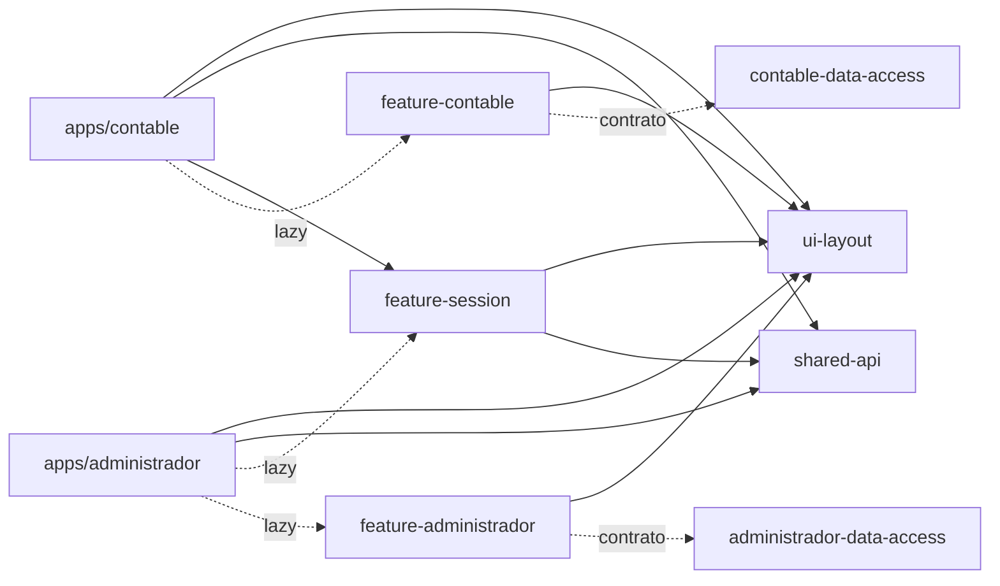

# Eterea · Clientes multiempresa

Clientes Angular para operar la contabilidad y la administración de varias
empresas desde un mismo espacio de trabajo. El repositorio está en **etapa de
estructura**: la navegación, las capas y el sistema de diseño están armados; la
lógica de negocio se incorpora en pasos posteriores.

## Stack

- **Angular 22** (standalone components, signals y rutas lazy).
- **Nx 23** como workspace multi-app (`apps/` + `libs/`).
- **Tailwind CSS 4** como base de estilos, con un sistema de diseño propio en CSS.
- **Vitest** previsto para la capa de datos (configuración pendiente).
- **ESLint + Prettier** con reglas de límites entre librerías.
- **Docker** multietapa con Nginx para publicar las apps.

## Puesta en marcha

```bash
npm install
npm start                    # contable en http://localhost:4220
npm run start:administrador  # administrador en http://localhost:4221
npm run build                # build de producción de contable
npm run build:administrador  # build de producción de administrador
npm run lint                 # lint de todos los proyectos
```

## Estructura

```text
apps/
├── contable/                   # host: bootstrap, rutas raíz y shell
└── administrador/              # host de administración global
libs/
├── shared-api/                 # tenant, interceptor, tokens, env y formato
├── ui-layout/                  # sistema de diseño: shell, iconos, page header
├── feature-session/            # login y selector de empresa (estructura visual)
├── contable-data-access/       # modelos y contrato del repositorio contable
├── feature-contable/           # rutas y páginas del módulo contable
├── administrador-data-access/  # modelos y contrato del repositorio de administración
└── feature-administrador/      # rutas y páginas del módulo administrador
```

### Capas

- **`apps/contable`** y **`apps/administrador`** son cascarones delgados:
  `main.ts`, `app.config.ts`, `app.routes.ts` y el shell. Las vistas no viven en
  las apps.
- **`feature-*`** contiene las vistas. `feature-contable` y
  `feature-administrador` se cargan con `loadChildren`; `feature-session` se
  importa de forma estática porque el shell de Contable también usa el diálogo de
  cambio de contexto.
- **`shared-api`** resuelve el contexto multiempresa:
  - `ContextoStore` mantiene la jerarquía empresa → negocio y la selección activa
    en `sessionStorage` (una por solapa).
  - `contextoInterceptor` agrega `X-Tenant-Id` con `negocio.tenantId`.
  - `contextoGuard` exige empresa y negocio elegidos.
  - `API_URL`, `APP_ENV_INFO` y helpers de formato son transversales.
- **`contable-data-access`** define los modelos base y el contrato
  `ContableRepository`. Todavía no tiene implementación HTTP.
- **`administrador-data-access`** define los modelos de empresa, negocio, usuario
  y asignaciones, más el contrato `AdministradorRepository`. El cliente de
  administración es global: no depende de una empresa activa.
- **`ui-layout`** concentra la identidad visual y no depende de ninguna otra
  librería del workspace.



Los límites están enforced por `@nx/enforce-module-boundaries` en
`eslint.config.mjs`.

## Rutas

### Contable

| Ruta                | Pantalla                   | Estado     |
| ------------------- | -------------------------- | ---------- |
| `/`                 | Resumen del módulo         | estructura |
| `/plan-cuentas`     | Plan de cuentas            | estructura |
| `/asientos`         | Asientos                   | estructura |
| `/mayor`            | Libro mayor                | estructura |
| `/balance`          | Balance e informes         | estructura |
| `/periodos`         | Períodos contables         | estructura |
| `/centros-costo`    | Centros de costo           | estructura |
| `/configuracion`    | Configuración              | estructura |
| `/login`            | Ingreso                    | operativa  |
| `/empresas`         | Selector empresa → negocio | operativa  |
| `/cambiar-password` | Cambiar contraseña         | operativa  |

### Administrador

| Ruta                | Pantalla                          | Estado     |
| ------------------- | --------------------------------- | ---------- |
| `/`                 | Resumen de la plataforma          | estructura |
| `/empresas`         | Empresas registradas              | estructura |
| `/negocios`         | Negocios y conexiones             | estructura |
| `/usuarios`         | Usuarios de la plataforma         | operativa  |
| `/asignaciones`     | Usuario–empresa y usuario–negocio | operativa  |
| `/configuracion`    | Parámetros generales              | estructura |
| `/login`            | Ingreso                           | operativa  |
| `/cambiar-password` | Cambiar contraseña                | operativa  |

## Autenticación y sesión

- Login común: `POST /api/brain/auth/login` (`shared-api` + `feature-session`).
- Cambio de contraseña: menú del usuario → `/cambiar-password`; usa
  `PUT /api/brain/core/usuario/{usuarioId}/password`, exige la contraseña actual y
  cierra la sesión al guardar.
- Access token JWT en memoria; refresh token opaco en cookie `HttpOnly`/
  `SameSite=Strict`.
- `authInterceptor` agrega el Bearer y refresca una vez ante `401`.
- Guards: `authGuard`, `guestGuard`, `adminGuard` y `contextoGuard`.
- El módulo Administrador exige `administrador = true`; Contable carga las
  empresas/negocios asignados y usa `negocio.tenantId` como `X-Tenant-Id`.
- En desarrollo, `proxy.conf.json` redirige `/api` al gateway en
  `http://localhost:9050`.

## Sistema de diseño

Identidad propia: **tinta editorial + ultramar eléctrico + lima ácida**.

- Tokens en `libs/ui-layout/src/styles/tokens.css` (tema claro y oscuro).
- Primitivas globales en `libs/ui-layout/src/styles/ui.css`: botones, tarjetas,
  campos, badges, tablas y utilidades.
- Shell responsive en `libs/ui-layout/src/lib/shell`, con navegación agrupada,
  contexto empresa/negocio, usuario y cambio de tema.
- Componentes compartidos: `et-icon`, `et-page-header`, `et-empty-state`.
- Tipografías: Sora (títulos), Inter (texto) y JetBrains Mono (importes).

Las reglas de uso están en [`AGENTS.md`](./AGENTS.md).

## Estado actual y próximos pasos

Listo:

- Workspace Nx con dos apps, siete librerías y aliases `@eterea/*`.
- Shell, navegación, tema claro/oscuro y páginas vacías de ambos módulos.
- Contrato de contexto (`ContextoStore`, interceptor, guard), pantalla obligatoria
  empresa → negocio, cambio de contexto en modal y contratos de datos.
- Login común contra Brain con JWT en memoria, refresh token en cookie HttpOnly,
  guards de sesión/rol, logout y carga real de empresas/negocios asignados.
- Cambio de contraseña desde el menú de usuario en ambos módulos, con cierre de
  sesión al completar.
- Administrador: listado de usuarios, blanqueo de contraseñas y asignaciones
  usuario–empresa / usuario–negocio con activación, desactivación y cascada.
- Build de producción y lint sin errores.

Pendiente de implementar por pasos:

1. Implementación HTTP de `ContableRepository`.
2. Plan de cuentas, asientos, mayor, balance, períodos y centros de costo.
3. Alta y edición de empresas y negocios desde el Administrador.
4. Pruebas unitarias de las capas de datos y de los cálculos contables.
5. Pipeline de despliegue y configuración de entornos.

## Docker

```bash
npm run docker:build
docker run --rm -p 8080:443 \
  -e API_URL=/api/tenant/core \
  -e ENV_NAME=local \
  -e APP_VERSION=local \
  eterea/contable:local

npm run docker:build:administrador
docker run --rm -p 8081:443 \
  -e API_URL=/api/brain/core \
  -e ENV_NAME=local \
  -e APP_VERSION=local \
  eterea/administrador:local
```

El `Dockerfile` compila desde el código fuente y publica los estáticos con Nginx,
incluyendo fallback de SPA. Cada contenedor sirve por HTTPS en `443` con
certificado auto-firmado (el `80` solo redirige) y proxya `/api/` al gateway
multitenant. `API_URL`, `ENV_NAME` y `APP_VERSION` se inyectan en runtime: el
bundle de producción solo contiene los placeholders.

> Nota: el gateway ya expone `/api/brain/**` para el login común y los endpoints
> de administración, además de `/api/tenant/core/**` y `/api/unificado/core/**`.
> El login legacy de tenant (`/api/v1/auth/**`) fue eliminado. Al implementar
> `AdministradorRepository`, usar `API_URL=/api/brain/core`.
